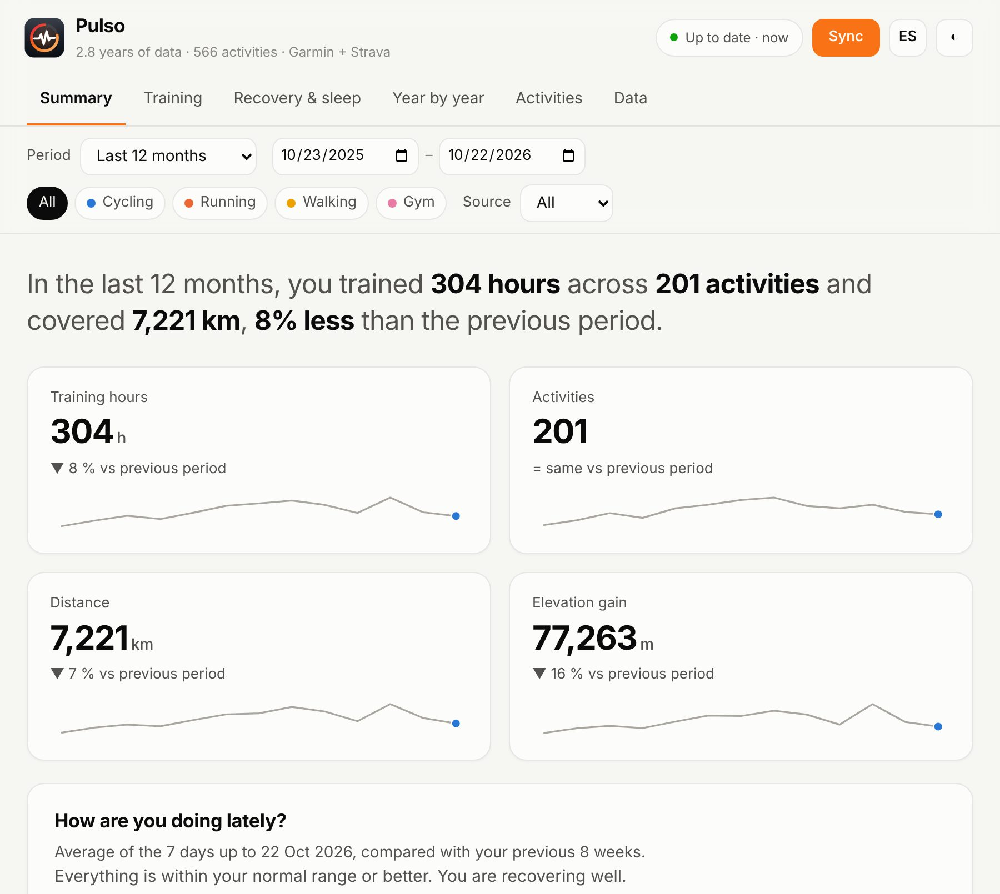
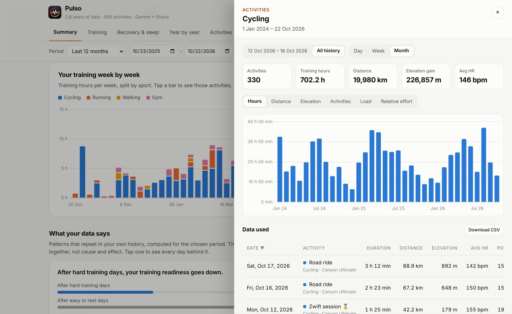
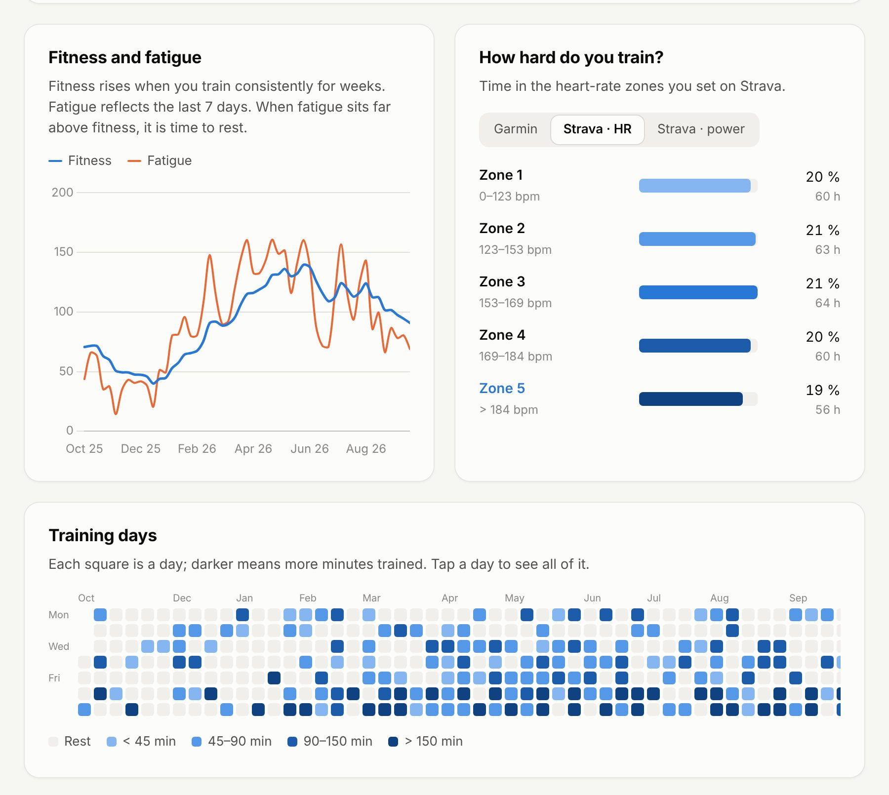
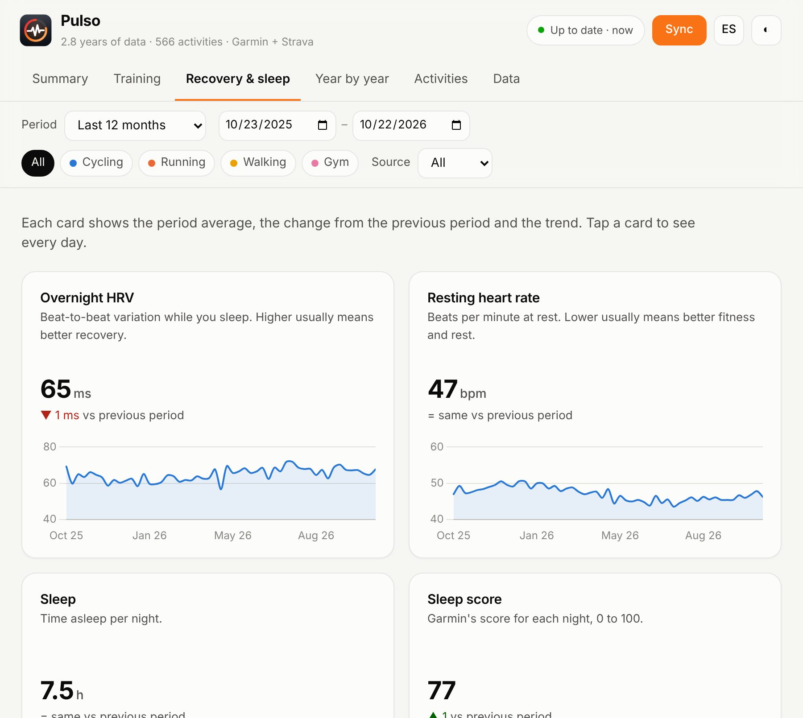
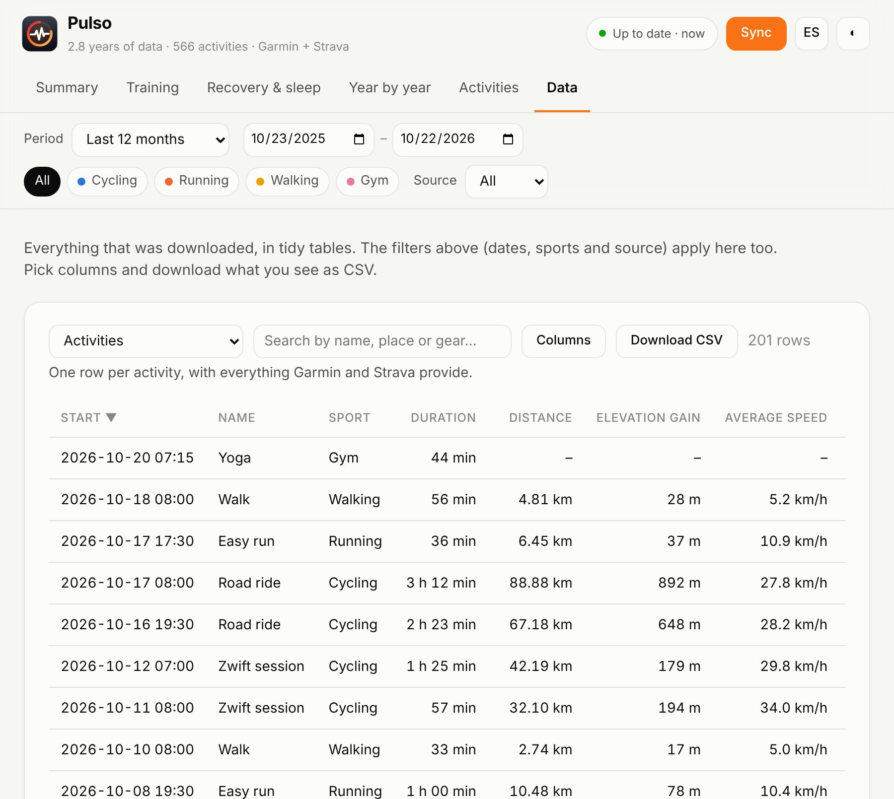
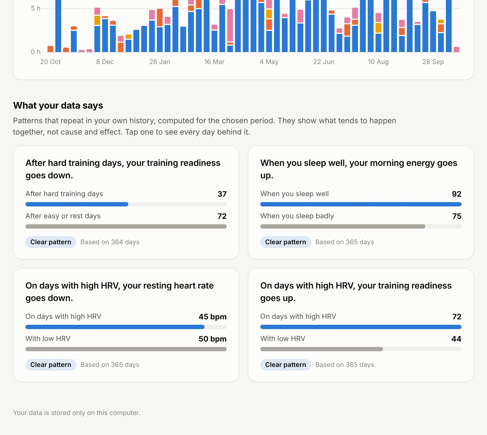
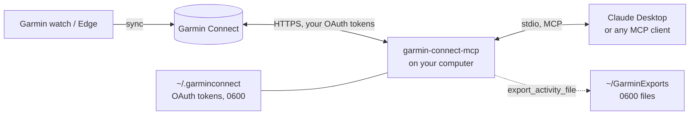

<h1 align="center">Garmin Connect MCP</h1>

<p align="center">
  Your Garmin data inside Claude and any MCP client — and a private dashboard of your whole<br/>
  training and health history, with correlations you won't find in Garmin Connect.<br/>
  Runs on your computer, on your own account.
</p>

<p align="center">
  <a href="https://github.com/scortes5/garmin-connect-mcp/actions/workflows/test.yml"></a>
  
  
  
  <a href="LICENSE"></a>
  <a href="https://github.com/scortes5/garmin-connect-mcp/stargazers"></a>
</p>

<p align="center">
  <a href="#installation"><b>Install</b></a> ·
  <a href="#dashboard"><b>Dashboard</b></a> ·
  <a href="#tools">Tools</a> ·
  <a href="#privacy-and-security">Privacy</a> ·
  <a href="CHANGELOG.md">Changelog</a> ·
  <a href="docs/ARCHITECTURE.md">Architecture</a> ·
  <a href="SECURITY.md">Security</a>
</p>

<p align="center">
  
  <br/><sub>Dashboard running on <code>--demo</code> data.</sub>
</p>

Garmin Connect MCP is a [Model Context Protocol](https://modelcontextprotocol.io) server that lets Claude (or any MCP client) read your Garmin Connect account. Ask in plain language — *"how did my long ride go?"*, *"am I recovered enough for intervals today?"*, *"chart HR and power for last Saturday"* — and the model pulls the real numbers instead of guessing.

It also ships a **local dashboard**: one command downloads your entire history (activities, sleep, HRV, Body Battery, stress, readiness, VO₂ max, training status, weight) — and, if you connect it, your **Strava** zones, best efforts, splits, segments and gear — and opens it as an interactive page. Filter any view by dates, sports and source, tap any number to see how it changed over time and the exact rows behind it, and browse or export every table as CSV.

It talks to Garmin Connect with **your own login**, stores nothing on any server, and keeps your tokens and exported files readable only by your user.

> **Fork of [eddmann/garmin-connect-mcp](https://github.com/eddmann/garmin-connect-mcp)** (MIT, © Edd Mann). This fork fixes tools that never worked upstream, adds the raw data you need to build dashboards, and tightens how credentials and personal data are handled. Every change is listed in [What this fork changes](#what-this-fork-changes).

> **Like it?** A ⭐ on the repo helps other athletes find it.

---

## Contents

- [What you can do](#what-you-can-do)
- [Dashboard](#dashboard)
- [How it works](#how-it-works)
- [Installation](#installation)
- [Connect it to Claude](#connect-it-to-claude)
- [Tools](#tools)
- [Resources and prompts](#resources-and-prompts)
- [Building your own charts](#building-your-own-charts)
- [What this fork changes](#what-this-fork-changes)
- [Privacy and security](#privacy-and-security)
- [Development](#development)
- [Known limitations](#known-limitations)
- [Contributing](#contributing)

---

## What you can do

| | |
|---|---|
| **Ask about any activity** | Distance, pace, power, HR zones, laps, weather, gear and training effect for every run, ride, swim or strength session. |
| **Chart the raw signal** | Downsampled time-series of heart rate, power, speed, cadence, elevation and temperature, ready to plot. |
| **Know your thresholds** | Lactate threshold (HR and pace), cycling FTP, race predictions and weekly running tolerance in one call. |
| **Check recovery** | Sleep stages and scores, overnight HRV, Body Battery, stress, training readiness and training status. |
| **Spot trends** | Weekly volume, activity mix, side-by-side comparisons and "find similar activities". |
| **Keep the originals** | Export the original `.fit` file — with every field the watch recorded — to a local folder. |
| **Track the rest** | Weight and body composition, goals, PRs, badges, challenges, devices, gear mileage, workouts. |

### Why this fork and not upstream?

| | Upstream 1.0.1 | This fork |
|---|---|---|
| `get_training_effect` | Always errors (calls a method that does not exist) | Aerobic/anaerobic TE, label, training load, HR time in zones |
| Fitness age in `get_performance_metrics` | Always `null` | Returned; failures explained per metric |
| `manage_workouts` → `get` | Always errors | Works |
| Activity time-series for charts | Not exposed | `get_activity_streams` |
| FTP, lactate threshold, race predictions | Partly, spread across tools | `get_fitness_thresholds` |
| Original `.fit` export | No | `export_activity_file` |
| Password on disk | Stored in plain text | Not stored by default |
| Logins to Garmin | One per tool call | One per server process |
| OAuth scopes and profile photo URLs in responses | Included | Stripped |
| `garminconnect` library | 0.3.3 | 0.3.19 (survives Garmin's 2026 Cloudflare changes) |

## Dashboard

```bash
garmin-connect-mcp auth          # once
garmin-connect-mcp dashboard     # open the app; it syncs in the background as it loads
```

The dashboard is a small local app: it opens straight away with what is already cached and syncs with Garmin in the background, with a progress indicator in the top bar, then refreshes itself when new data lands. The first run downloads every year since your oldest activity (a few hundred requests, a couple of minutes, deliberately paced) and shows a progress screen while it does. After that, only the last week and anything new is fetched, so a refresh takes seconds. If the sync fails (for example, the Garmin login expired) the app says so and keeps showing your saved data. Try it without an account: `garmin-connect-mcp dashboard --demo`.

| Section | What you see |
|---|---|
| **Summary** | One sentence with the period's totals and the change vs the period before; four key numbers with a mini trend; **"How are you doing lately?"** — the last 7 days of HRV, resting HR, sleep, morning energy and stress against your own normal range, labelled *better / normal / worse*; weekly hours by sport; and up to four findings from your data written as plain sentences (*"After hard training days, your readiness goes down: 37 vs 72"*). |
| **Training** | Hours, distance and share of time per sport; month-by-month hours; fitness vs fatigue (weekly); time in each heart-rate zone (Garmin's, or your Strava heart-rate and power zones); a calendar of training days; your best marks of the period; with Strava, your best running times per distance and your gear's mileage. |
| **Recovery & sleep** | One card per metric — HRV, resting HR, sleep hours and score, morning energy (Body Battery), stress, readiness, steps, breathing, pulse ox, relative effort — each with a one-line explanation, the period average, the change vs the previous period and a trend; sleep stages, bed and wake times and regularity; VO₂ max, weight and endurance score. |
| **Year by year** | Running total since 1 January with the selected year highlighted against the others (hours, distance, elevation or activities), and a year table with the best year per column in bold. |
| **Activities** | Every activity, searchable by name, place or gear, sortable by any column. |
| **Data** | Every table the dashboard has — daily metrics, activities, time in zones, best efforts, per-km splits, segments, laps, best power per duration, VO₂ max, weight, endurance, gear — with a column picker, search, a data dictionary and **CSV download**. |

**Filters.** One bar drives every view: a period (last 30 or 90 days, last 12 months, this year, any single year, all history, or any custom range picked with two dates), the sports to include, and — with Strava connected — the source (Garmin, Strava or both). The comparison with the previous period, the findings and every chart follow it.

**Tap anything.** Every number, card, bar, zone, calendar day, record, finding and table row opens a side panel with its history (by day, week or month; the chosen period or all history) and the rows it was computed from, ready to export. An activity shows every field Garmin and Strava recorded — zones, power curve against your best of the period, splits, segments, laps, best efforts — and any of its values opens how that value has varied across your activities of that sport.

<p align="center">
  
</p>

<p align="center">
  
  
  
</p>

<p align="center">
  
</p>

### Strava

```bash
garmin-connect-mcp dashboard strava     # or the "Connect Strava" card inside the app
```

Strava adds what Garmin does not give the dashboard: your heart-rate and power zones as set on Strava and the time spent in them per activity, running best efforts (400 m … marathon) with PR ranks, per-kilometre splits, segment efforts, laps, relative effort, kudos and achievements, the device and the gear of each activity, and the total mileage of your bikes and shoes. Activities recorded somewhere else (a phone, Zwift, another watch) are added too.

To connect, create your own API application at [strava.com/settings/api](https://www.strava.com/settings/api) (any name and website; *Authorization Callback Domain*: `localhost`), then paste its Client ID and Client Secret into the app or the terminal and authorize. Pulso asks for `read,activity:read_all,profile:read_all` and nothing else; the tokens are stored `0600` in `~/.garmin-dashboard/strava.json` and refreshed automatically. `garmin-connect-mcp dashboard strava --disconnect` forgets them.

Strava then syncs with Garmin every time the app opens. An activity Garmin uploaded to Strava is recognised by its Garmin ID (or, failing that, by its start time and sport) and **enriched**, never counted twice. Strava allows 100 requests per 15 minutes and 1,000 per day: activity lists cost one request per 200 activities, full detail two requests per activity, so a long history is completed newest first over several syncs; the Data tab says how many are still pending. Maps, coordinates, your name and photos are removed before anything is written to disk.

### Correlations

Your history is turned into one row per day, then tested two ways:

- **A matrix** of 18 daily metrics (training load, steps, HRV, resting HR, sleep score and stages, bedtime, stress, Body Battery, readiness, form…), Pearson r.
- **24 lagged hypotheses** — the questions athletes actually ask: does a hard day lower *tonight's* HRV? Does going to bed late cost sleep score? Does a high acute:chronic ratio show up in readiness? Each reports Pearson r, Spearman ρ, p-value, number of days, and the average outcome on your top-quartile vs bottom-quartile days.

Findings are recomputed in the page for whatever period the filter selects. Only relationships with at least 30 days of data and p < 0.05 are shown as findings; tap one to see the scatter of every day behind it. Rest days count as zero training load, so load is compared against rest, not just easy days against hard ones. These are associations in your own data, not medical advice and not proof of cause.

### Options

| Command | |
|---|---|
| `garmin-connect-mcp dashboard` | Open the app on `127.0.0.1`; it syncs on every open (skipped if it synced in the last 5 minutes) and has a **Sync** button. Stops itself a couple of minutes after the last tab closes. |
| `… --no-sync` | Offline: show the cache, no automatic sync. |
| `… --full` | Re-download all history (after editing old activities). |
| `… --since 2022` | Start from a given year. |
| `… --static` | Sync, then write a standalone `~/.garmin-dashboard/dashboard.html` instead of running the app. |
| `… --output FILE` / `--no-open` | Write the static page elsewhere (implies `--static`) / don't open the browser. |
| `… --demo` | Synthetic athlete, no account needed. Never touches your real cache. |
| `… --window` | Open in its own app window (Chrome, Edge or Brave) instead of a browser tab. |
| `garmin-connect-mcp dashboard strava` | Connect your Strava account (guided). `--disconnect` forgets it; downloaded data stays. |
| `garmin-connect-mcp dashboard install-app` | macOS: installs **Pulso.app** (with its icon) in `~/Applications` — open it from Launchpad, Spotlight or the Dock; it runs the app in its own window. |

From a checkout, the same commands are `make dashboard`, `make dashboard/static`, `make dashboard/demo`, `make dashboard/strava` and `make app`. The demo includes a simulated Strava account.

The page is a single file with Chart.js inlined: it opens offline and loads nothing from the internet. It contains your health history, so it is written `0600` and lives outside the repository. Spanish and English, light and dark theme.

---

## How it works



- The server is a local process that Claude starts over **stdio**. It never opens a network port.
- It signs in to Garmin Connect once with your account, keeps the OAuth tokens in `~/.garminconnect/`, and refreshes them automatically.
- Each answer is compact JSON with `data`, optional `analysis` (insights and per-metric errors) and `metadata`.

---

## Installation

Requirements: [uv](https://docs.astral.sh/uv/) (it installs Python 3.12+ for you). Docker works too.

### 1. Sign in once

```bash
uvx --from git+https://github.com/scortes5/garmin-connect-mcp garmin-connect-mcp auth
```

- Asks for your Garmin email and password (the password is **hidden** while you type) and for the MFA code if your account has one.
- Saves OAuth tokens to `~/.garminconnect/` and only your **email** to `~/.garminconnect.env` (mode `0600`).
- **The password is used once and thrown away.** Tokens last for months and refresh by themselves.

Want the server to be able to sign in again by itself if Garmin ever revokes the tokens? Add `--save-password`; it is then kept in `~/.garminconnect.env`, readable only by you.

### 2. (Optional) choose where exports go

```bash
export GARMIN_EXPORT_DIR="$HOME/GarminExports"   # default
```

### Option: Docker

```bash
git clone https://github.com/scortes5/garmin-connect-mcp && cd garmin-connect-mcp
docker build -t garmin-connect-mcp .
touch garmin-connect-mcp.env && mkdir -p ~/.garminconnect-docker
docker run -it --rm \
  -v "$PWD/garmin-connect-mcp.env:/app/.env" \
  -v "$HOME/.garminconnect-docker:/root/.garminconnect" \
  garmin-connect-mcp auth
```

### Option: from source

```bash
git clone https://github.com/scortes5/garmin-connect-mcp && cd garmin-connect-mcp
make deps
make auth
```

---

## Connect it to Claude

Open **Claude Desktop → Settings → Developer → Edit Config** (`~/Library/Application Support/Claude/claude_desktop_config.json` on Mac, `%APPDATA%\Claude\claude_desktop_config.json` on Windows) and add:

```json
{
  "mcpServers": {
    "garmin": {
      "command": "uvx",
      "args": [
        "--from",
        "git+https://github.com/scortes5/garmin-connect-mcp",
        "garmin-connect-mcp"
      ]
    }
  }
}
```

<details>
<summary>From a local checkout</summary>

```json
{
  "mcpServers": {
    "garmin": {
      "command": "uv",
      "args": ["run", "--directory", "/ABSOLUTE/PATH/TO/garmin-connect-mcp", "garmin-connect-mcp"]
    }
  }
}
```
</details>

<details>
<summary>With Docker</summary>

```json
{
  "mcpServers": {
    "garmin": {
      "command": "docker",
      "args": [
        "run", "-i", "--rm",
        "-v", "/ABSOLUTE/PATH/TO/garmin-connect-mcp.env:/app/.env",
        "-v", "/ABSOLUTE/PATH/TO/.garminconnect-docker:/root/.garminconnect",
        "-v", "/ABSOLUTE/PATH/TO/GarminExports:/root/GarminExports",
        "garmin-connect-mcp"
      ]
    }
  }
}
```
</details>

Restart Claude Desktop and try:

```
How did I sleep this week, and how did it affect my HRV?
Compare my last three long rides: power, heart rate and decoupling.
Chart heart rate and power for my last ride.
What are my current FTP and lactate threshold?
Am I ready for intervals today?
Export the original FIT file of yesterday's run.
```

---

## Tools

24 tools in 9 groups. Every read-only tool is marked `readOnlyHint` so clients can run it without asking.

### Raw performance data (new)

| Tool | What it returns |
|---|---|
| `get_activity_streams` | Aligned columns — elapsed time, distance, HR, speed, power, cadence, elevation, temperature — downsampled to `max_points` (default 500). GPS only with `include_gps=true`. |
| `get_fitness_thresholds` | Lactate threshold, cycling FTP, race predictions (5K → marathon), weekly running tolerance. Each part is fetched on its own; failures go to `analysis.errors`. |
| `export_activity_file` | Saves `fit` (original), `gpx`, `tcx` or `csv` to `$GARMIN_EXPORT_DIR`, mode `0600`. Nothing is uploaded anywhere. |

### Activities

| Tool | What it returns |
|---|---|
| `query_activities` | Activities by ID, date, date range or most recent, filtered by type, with cursor pagination. |
| `get_activity_details` | One activity with laps/splits (accurate km/mile splits from time-series), weather, HR zones, gear and strength sets. |

### Analysis

| Tool | What it returns |
|---|---|
| `compare_activities` | 2–5 activities side by side. |
| `find_similar_activities` | Past activities similar to a reference one. |

### Training

| Tool | What it returns |
|---|---|
| `analyze_training_period` | Volume, activity mix and weekly trend for `7d`, `30d`, `90d`, `ytd`, a month or any date range. |
| `get_performance_metrics` | VO2 max, HRV, fitness age (single day) or hill and endurance score (range). |
| `get_training_effect` | Aerobic/anaerobic training effect, label, training load and HR time in zones for an activity; or a progress summary between two dates. |

### Health and wellness

| Tool | What it returns |
|---|---|
| `query_health_summary` | Daily stats with training readiness, training status and Body Battery. |
| `query_sleep_data` | Sleep stages, scores and overnight HRV. |
| `query_heart_rate_data` | Daily heart rate and resting HR. |
| `query_activity_metrics` | Steps, stress, respiration, SpO2, floors, intensity minutes. |

### Profile, goals and challenges

| Tool | What it returns |
|---|---|
| `get_user_profile` | Profile, stats and PRs. |
| `query_goals_and_records` | Goals, personal records and race predictions. |
| `query_challenges` | Badges and challenges by status. |

### Devices and gear

| Tool | What it returns |
|---|---|
| `query_devices` | Devices, primary training device, settings, solar data, alarms. |
| `query_gear` | Shoes, bikes and other gear with usage stats. |

### Body and data entry

| Tool | What it returns |
|---|---|
| `query_weight_data` | Weight and body composition for a date or range. |
| `manage_weight_data` | Add or delete weigh-ins. **Writes to your account.** |
| `log_health_data` | Log body composition, blood pressure or hydration. **Writes to your account.** |

### Other

| Tool | What it returns |
|---|---|
| `manage_workouts` | List, get, download or upload structured workouts. `upload` **writes to your account.** |
| `query_womens_health` | Menstrual cycle and pregnancy data. |

---

## Resources and prompts

**Resources** give the model context without a tool call:

| Resource | Content |
|---|---|
| `garmin://athlete/profile` | Name, unit system, summary and today's stats. |
| `garmin://training/readiness` | Training readiness, morning readiness, Body Battery, HRV and training status for today. |
| `garmin://health/today` | Today's steps, sleep, stress and heart rate. |

**Prompts** are ready-made requests you can pick in Claude:

| Prompt | Does |
|---|---|
| `analyze_recent_training` | Training analysis for a period. |
| `sleep_quality_report` | Sleep quality with recommendations. |
| `training_readiness_check` | Train hard, train easy or rest. |
| `activity_deep_dive` | Everything about one activity, compared with similar ones. |
| `compare_recent_runs` | Trends across your latest runs. |
| `health_summary` | Steps, sleep, stress, HR, HRV and Body Battery together. |

---

## Building your own charts

The new tools are shaped for charts:

- `get_activity_streams` returns **columns**, not rows: `streams.heart_rate_bpm[i]` lines up with `streams.elapsed_s[i]`, so they map straight onto a line chart. Columns the device did not record are left out.
- `get_fitness_thresholds` gives the reference lines (FTP, LTHR) to draw over those charts.
- `export_activity_file` with `fit` gives you the full-resolution original for your own pipeline (for example parsing with the [FIT SDK](https://developer.garmin.com/fit/) into PostgreSQL).

Garmin's official **personal API** (announced October 2026) also returns activity JSON and FIT files for your own account, but it is pull-only, and third-party reports say files delivered through Garmin's APIs have undocumented fields such as VO2 max and recovery time removed. The original file you export here is the one Garmin Connect itself serves to you.

---

## What this fork changes

**Fixed**

- `get_training_effect` called a Garmin method that does not exist; it now reads the values from the activity.
- Fitness age always came back `null` (wrong method name). `get_performance_metrics` now explains each metric it could not fetch in `analysis.errors`.
- `manage_workouts` with `action="get"` called a method that does not exist.
- `garmin://training/readiness` returned generic daily stats; it now returns readiness, Body Battery, HRV and training status.
- Accurate splits now find the distance and time columns through Garmin's metric descriptors instead of fixed positions.

**Added**

- `get_activity_streams`, `get_fitness_thresholds`, `export_activity_file`.
- `auth --save-password`.
- A secret scan ([gitleaks](https://github.com/gitleaks/gitleaks)) on every push.

**Changed**

- Password not stored by default; hidden prompt; token-only operation.
- One login per server process, dropped and re-created after an auth error.
- `userRoles` and profile image URLs stripped from all responses.
- `garminconnect` ≥ 0.3.19.

**Removed**

- `get_activity_social`: the Garmin library has no endpoint behind it, so it always failed.

Full detail in the [Changelog](CHANGELOG.md).

---

## Privacy and security

- **Runs only on your computer.** The server talks to Garmin Connect and to the MCP client that started it — nothing else. No telemetry, no server of its own, no network port.
- **Your password is not kept.** `auth` uses it once to get OAuth tokens. Only if you pass `--save-password` is it stored, in a `0600` file.
- **Files only you can read.**

  | File | What | Permissions |
  |---|---|---|
  | `~/.garminconnect/` | OAuth tokens | folder `0700`, files `0600` |
  | `~/.garminconnect_base64` | Token copy for Docker/CI | `0600` |
  | `~/.garminconnect.env` | Email (and password only with `--save-password`) | `0600` |
  | `$GARMIN_EXPORT_DIR/*.fit` | Exported activities | `0600` |

- **No location unless you ask.** Streams leave out latitude and longitude by default: the start and end of most activities is your home.
- **Less account detail in answers.** OAuth scopes and profile photo URLs are removed from every response before the model sees it.
- **Writes are labelled.** Tools that change your Garmin account (`manage_weight_data`, `log_health_data`, `manage_workouts` upload) are marked as not read-only, so clients ask before running them.
- **Dashboard data stays local.** Synced data lives in `~/.garmin-dashboard/` (folders `0700`, files `0600`; override with `GARMIN_DASHBOARD_DIR`). Owner name, account roles and GPS coordinates are dropped from activities before they are cached. The app listens on `127.0.0.1` only and rejects requests from other hosts or origins.
- **Repository hygiene.** `.gitignore` excludes tokens, `.env` files, `.fit/.gpx/.tcx`, databases and exports; CI runs a secret scan on every push. Tests use made-up data only.

Found a problem? See [SECURITY.md](SECURITY.md).

---

## Development

```bash
make deps          # install dependencies (uv)
make test          # run the test suite
make lint          # ruff + pyright
make can-release   # everything CI runs
make auth          # sign in from a checkout
make run           # start the server on stdio
```

See [docs/ARCHITECTURE.md](docs/ARCHITECTURE.md) for how the pieces fit together and the full data dictionary.

Tests are behaviour tests: they drive the real MCP server through an in-memory client and fake Garmin only at the library boundary.

```
src/garmin_connect_mcp/
  server.py            tools, resources and prompts registration
  middleware.py        one shared Garmin session per process
  client.py            login, token handling, error mapping
  auth.py              config, token-only auth, private file writes
  response_builder.py  compact JSON responses, field redaction
  tools/               one module per area (activities, training, performance_data…)
  dashboard/           sync → cache → dataset → correlations → self-contained HTML
tests/                 behaviour and unit tests
```

---

## Known limitations

- Garmin Connect has no public API for individuals; this uses the same endpoints as the Garmin Connect website through the [`garminconnect`](https://github.com/cyberjunky/python-garminconnect) library. Garmin can change them at any time.
- Metrics depend on your device: a watch without a power meter returns no power stream, and some devices have no running tolerance or hill score. Missing parts are reported in `analysis.errors`.
- Very frequent calls can trigger Garmin rate limits (HTTP 429). Wait a few minutes and try again.
- Social data (likes, comments) is not available.

---

## Contributing

Bug reports and pull requests are welcome. Run `make can-release` before opening a PR, and never paste real tokens, exports or personal activity data into issues, fixtures or tests. Fixes that also apply upstream are worth sending to [eddmann/garmin-connect-mcp](https://github.com/eddmann/garmin-connect-mcp) too.

This project is not affiliated with, endorsed by, or sponsored by Garmin Ltd. or its affiliates. Garmin and Garmin Connect are trademarks of Garmin Ltd.

---

Made by Sergio Cortés · based on [garmin-connect-mcp](https://github.com/eddmann/garmin-connect-mcp) by Edd Mann · [MIT License](LICENSE)
