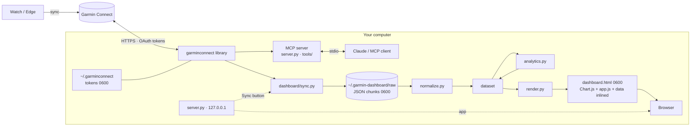

# Architecture

Garmin Connect MCP has two front ends over one Garmin client:

1. **The MCP server** (`garmin-connect-mcp`): Claude or any MCP client calls tools over stdio and gets compact JSON.
2. **The dashboard** (`garmin-connect-mcp dashboard`): downloads your history into a local cache and renders a self-contained HTML app.

Both run only on your computer and talk only to Garmin Connect.



---

## Repository layout

```
src/garmin_connect_mcp/
  cli.py                 entry point: server | auth | dashboard
  auth.py                config, token detection, private (0600) file writes
  client.py              login, one cached session per process, error mapping
  middleware.py          injects the Garmin client into every MCP tool call
  server.py              MCP tools, resources and prompts
  response_builder.py    compact responses, redaction of account fields
  tools/                 one module per MCP tool group
  dashboard/
    sources.py           the Garmin endpoints read, and their window sizes
    cache.py             raw responses on disk, one file per source and window
    sync.py              incremental download
    normalize.py         raw responses -> one row per day + activities + series
    analytics.py         correlation matrix and lagged hypotheses
    render.py            inlines CSS, Chart.js, app.js and the data into one page
    server.py            local app server: page, background sync, status
    demo.py              synthetic account used by --demo
    cli.py               argument parsing, macOS app installer
    assets/              dashboard.html, styles.css, app.js, Chart.js 4.4.1 (MIT)
tests/                   behaviour tests; Garmin faked at the library boundary
docs/                    this file, screenshots
```

---

## Dashboard pipeline

### 1. Sync (`sync.py`, `sources.py`)

Each source is one Garmin range endpoint with the widest window it answers reliably. Wider requests are either rejected (`HTTP 400 … must be P1Y or less`) or silently truncated, which was measured against a real account:

| Source | Library call | Window | Gives |
|---|---|---|---|
| `daily_summaries` | `get_daily_summaries` | 366 d | steps, floors, calories, HR, intensity minutes, stress, Body Battery, respiration, SpO₂ |
| `sleep` | `get_sleep_daily` | 28 d | score, duration, stages, sleep need, bedtime/wake time, skin temperature |
| `hrv` | `get_hrv_data_range` | 28 d | overnight HRV, 7-day average, balanced baseline |
| `readiness` | `get_training_readiness_range` | 28 d | training readiness, recovery time |
| `training_status` | `get_weekly_training_status` | 91 d | acute and chronic load, ACWR, training status code |
| `max_metrics` | `get_max_metrics_range` | 366 d | VO₂ max (running and cycling) |
| `endurance` | `get_endurance_score` | 366 d | weekly endurance score |
| `body_composition` | `get_body_composition` | 366 d | weight, BMI, body fat |
| `activities` | `get_activities_by_date` | 366 d | every activity summary |

Windows never cross a calendar year (`windows()`), so a window's key is stable from one run to the next.

**Incremental rule.** A cached window is reused when it ended more than `SETTLE_DAYS` (7) ago — Garmin keeps revising recent days (late syncs, sleep re-scoring, readiness recalculations). Everything else is fetched again. When "today" moves, the open window (e.g. `2026-10-01_2026-10-22`) is replaced by the longer one instead of being duplicated (`drop_overlapping`). `--full` ignores the cache.

**Start year.** The year of the oldest activity (`count_activities` + `get_activities(total-1, 1)`), remembered in `meta.json`; `--since` overrides it.

**Failures** of one endpoint or window are recorded in `meta.json` and shown in the dashboard footer; the rest of the sync continues.

**Pacing.** 0.25 s between requests. A first sync of ~5 years is ~300 requests.

### 2. Cache (`cache.py`)

```
~/.garmin-dashboard/            0700   (GARMIN_DASHBOARD_DIR overrides)
  meta.json                     0600   first_year, last_sync, errors
  dashboard.html                0600   last rendered page
  app.log                              output of the macOS app
  raw/<source>/<start>_<end>.json  0600  raw Garmin response
```

Raw responses are kept as Garmin sent them, so changing how data is normalised never requires downloading again. The only exception is activities: owner name, profile image URLs, account roles and start/end coordinates are removed **before** writing.

### 3. Normalise (`normalize.py`)

Produces the dataset embedded in the page:

```jsonc
{
  "generatedAt": "2026-10-22T16:23:00-03:00",
  "lastSync": "…", "syncErrors": [],
  "years": ["2021", …, "2026"],
  "days": { "date": ["2021-10-07", …], "steps": [8123, …], "hrv": [null, …], … },  // columnar
  "activities": [ { "id": …, "date": "2026-10-12", "sport": "cycling", "km": 42.1, … } ],
  "vo2": [ { "date": …, "sport": "cycling", "value": 49.6 } ],
  "endurance": [ { "date": …, "value": 6120 } ],
  "weight": [ { "date": …, "kg": 74.1, "fat": null, "bmi": 23.4 } ],
  "correlations": { … }   // added by analytics.py
}
```

`days` is columnar (one array per metric, aligned with `date`) to keep the page small: five years is ~0.9 MB of HTML including Chart.js.

Rules worth knowing:

- **Sleep, HRV and readiness are labelled with the morning you woke up.** The night after a workout on day *d* appears on *d + 1*.
- **Bedtime wraps past midnight**: going to bed at 01:30 is `25.5`, so "later" is always "bigger".
- **Readiness** is recalculated during the day; the `AFTER_WAKEUP_RESET` (morning) value is kept.
- **Training status** comes from your primary training device when several devices report.
- **Rest days are zero load**, not missing: any day with wellness data and no activity gets `actN = actMin = actKm = actElev = actLoad = 0`.
- **CTL / ATL / TSB** are computed from Garmin's per-activity training load with 42- and 7-day exponential averages (TSB is the form going *into* the day).

### 4. Analytics (`analytics.py`)

Pure Python, no NumPy.

- **Scopes:** `all`, `365` (last 365 days) and each year — the same keys as the period selector.
- **Matrix:** Pearson r for every pair of `MATRIX_METRICS` on the same day; cells with fewer than 20 days are empty.
- **Hypotheses (`PAIRS`):** `(x, y, lag)`; lag 1 pairs *x* on day *d* with *y* on *d + 1*. For each: Pearson r, Spearman ρ, n, two-sided p-value (t statistic with a normal approximation, accurate to two decimals for n ≥ 20), regression slope and intercept, and the mean of *y* for the bottom and top quartile of *x*. For zero-inflated *x* (training load) the "top" group is every day above the bottom group.
- The page shows a hypothesis as a **finding** when p < 0.05 and |r| ≥ 0.12.

The scatter explorer recomputes r in the browser for any pair the user picks.

### 5. Render (`render.py`, `assets/`)

`dashboard.html` has five markers replaced in order: styles, Chart.js, `app.js`, the live flag, and last the data (so no marker is ever searched for inside user text). JSON is escaped so `</script>` in an activity name cannot close the script element. The result needs no network.

`app.js` is a dependency-free single-page app: five tabs, a period selector, i18n (ES/EN, `?lang=`), theme (auto/dark/light), and one render function per tab. Preferences are kept in `localStorage` when available. Design rules: plain words instead of acronyms (each metric carries a one-line explanation in `METRICS`), one y-axis per chart, weekly or monthly averages instead of noisy daily series, and colours as roles in `styles.css` — sports use a fixed categorical order validated for colour-vision deficiency in light and dark, magnitudes an ordinal blue ramp. Findings are the significant hypothesis pairs from `analytics.py`, phrased per metric in `X_PHRASE` / `Y_NOUN`.

### 6. Serve (`dashboard/server.py`)

`garmin-connect-mcp dashboard` (unless `--static`) starts `ThreadingHTTPServer` on `127.0.0.1` (random port unless `--port`) and opens the browser at once — it does not sync first:

| Route | |
|---|---|
| `GET /` | Rebuilds the page from the cache on every load. |
| `POST /api/sync` | Starts an incremental sync in a background thread and returns 202 (200 with `started: false` if one is running). With `{"auto": true}` — sent by the page as it opens — it is also skipped when a sync finished in the last 5 minutes, so the reload that shows new data does not sync again. |
| `GET /api/status` | `state` (`idle`/`running`/`done`/`error`), `done`/`total` requests, current `source`, and the `result` or `error` of the last run. |
| `POST /api/ping` | Heartbeat from open tabs. |

The page shows cached data immediately (or, with an empty cache, a first-run progress screen), polls `/api/status` while a sync runs, and reloads once it downloaded something. A failure (e.g. expired login) is shown in a banner while the cached data stays on screen. Cache files are written to a temporary name and renamed, so a page built mid-sync never reads half a file.

Requests whose `Host` is not `127.0.0.1:<port>` / `localhost:<port>` (DNS rebinding) or whose `Origin` is another site (cross-site POST) get 403. The server exits 2 minutes after the last heartbeat, or 10 minutes after start if no tab ever connects — so the macOS app does not leave processes behind. It never stops while a sync is running.

`install-app` writes `~/Applications/Pulso.app` (icon from `assets/icon.icns`, rendered from `assets/icon.svg`), a bundle whose executable runs `python -m garmin_connect_mcp.cli dashboard --window` with the interpreter that installed it.

---

## Data dictionary

Every daily metric in `dataset.days`. Units are metric.

| Key | Meaning | Unit | Source |
|---|---|---|---|
| `steps`, `stepGoal` | Steps and daily goal | count | daily_summaries |
| `floors` | Floors climbed | count | daily_summaries |
| `kcal`, `kcalActive` | Total and active calories | kcal | daily_summaries |
| `imMod`, `imVig` | Moderate / vigorous intensity minutes | min | daily_summaries |
| `rhr`, `hrMin`, `hrMax` | Resting, minimum, maximum heart rate | bpm | daily_summaries |
| `stress`, `stressMax` | Average and max stress (0–100) | – | daily_summaries |
| `stressHighMin`, `stressRestMin` | Time in high stress / rest | min | daily_summaries |
| `bbMax`, `bbMin` | Body Battery high and low | 0–100 | daily_summaries |
| `bbCharged`, `bbDrained` | Body Battery charged / drained | points | daily_summaries |
| `resp` | Average respiration | brpm | daily_summaries |
| `spo2` | Average pulse ox | % | daily_summaries |
| `sleepScore` | Sleep score | 0–100 | sleep |
| `sleepH`, `deepH`, `remH`, `lightH`, `awakeH` | Total sleep and stages | h | sleep |
| `sleepNeedH` | Garmin's sleep need | h | sleep |
| `bedtime`, `wake` | Local time asleep / awake (bedtime may exceed 24) | h of day | sleep |
| `skinTemp` | Skin temperature deviation from baseline | °C | sleep |
| `bbSleep` | Body Battery gained overnight | points | sleep |
| `hrv`, `hrvWeek` | Overnight HRV and 7-day average | ms | hrv |
| `hrvLow`, `hrvHigh` | Balanced baseline band | ms | hrv |
| `readiness` | Morning training readiness | 0–100 | readiness |
| `recoveryH` | Recovery time at that moment | h | readiness |
| `acute`, `chronic` | Garmin acute and chronic load | load | training_status |
| `acwr` | Acute:chronic workload ratio | ratio | training_status |
| `tStatus` | Garmin training status code (0–7) | code | training_status |
| `actN`, `actMin`, `actKm`, `actElev`, `actLoad` | Activities that day: count, minutes, km, elevation gain, summed training load | – | activities |
| `lastEnd` | Local hour the last activity ended | h of day | activities |
| `ctl`, `atl`, `tsb` | Fitness (42 d), fatigue (7 d), form = CTL − ATL | load | derived |

Fields of each entry in `dataset.activities`:

| Key | Meaning |
|---|---|
| `id`, `date`, `start` | Garmin activity ID, local date, local start `YYYY-MM-DD HH:MM` |
| `type`, `sport` | Garmin type key and grouped sport (`cycling`, `running`, `swimming`, `walking`, `gym`, `other`) |
| `name`, `place` | Activity name and Garmin's location name |
| `km`, `min`, `movMin`, `elev`, `kmh` | Distance, elapsed and moving minutes, elevation gain (m), average speed |
| `hr`, `hrMax`, `kcal` | Average and max heart rate, calories |
| `watts`, `np`, `wMax`, `tss`, `if` | Average, normalised and max power, TSS, intensity factor |
| `te`, `ta`, `load`, `label` | Aerobic and anaerobic training effect, training load, Garmin's effect label |
| `cad`, `vo2`, `bb`, `tMin`, `tMax` | Cadence, VO₂ max estimate, Body Battery impact, min/max temperature |
| `zones` | Minutes in HR zones 1–5 |
| `power` | Best average power for 5 s … 60 min (`{"1200": 263}` = 20 min) |
| `end`, `pr` | Local end hour, personal record flag |

Fields that a device did not record are omitted, never zero.

---

## MCP server

`server.py` registers 24 tools, 3 resources and 6 prompts with FastMCP. `ConfigMiddleware` resolves one authenticated Garmin client per process (`client.get_cached_client`) and puts it in the tool context; it is dropped and recreated after an authentication error. `response_builder.py` returns compact JSON and strips account fields (`userRoles`, profile image URLs) from every response. Tools that write to your Garmin account are not marked read-only, so clients ask before running them.

---

## Security model

| Asset | Protection |
|---|---|
| OAuth tokens | `~/.garminconnect`, folder `0700`, files `0600`; password not stored unless `--save-password` |
| Synced health data | `~/.garmin-dashboard`, folders `0700`, files `0600`; identity and GPS stripped from activities |
| Rendered page | `0600`, no external requests, user text escaped inside `<script>` |
| Local server | `127.0.0.1` only, Host and Origin checks, no CORS, idle shutdown |
| Repository | `.gitignore` excludes tokens, env files, exports and data; gitleaks on every push; tests use invented data |

---

## Testing

`make can-release` runs ruff, pyright and pytest — the same as CI. Tests drive real code and fake Garmin only where the `garminconnect` library would make HTTP calls. `tests/test_dashboard.py` uses a deterministic fake account (trains every third day, hard days lower next-night HRV) and checks the pipeline end to end: windows requested, incremental behaviour, private permissions, stripped fields, normalisation rules, that the correlation engine finds the planted relationship, HTML escaping, the CLI and the local server's Host/Origin checks.

## Extending the dashboard

1. **New Garmin source:** add a `Source` in `sources.py` with its safe window, then parse it in `normalize.py`.
2. **New daily metric:** add it to `DAY_METRICS` (Python) and `METRICS` (`app.js`: labels, unit, decimals, which direction is better).
3. **New hypothesis:** append `(x, y, lag)` to `PAIRS` in `analytics.py`; it appears in the findings when significant.
4. Add a test in `tests/test_dashboard.py` and run `make can-release`.
